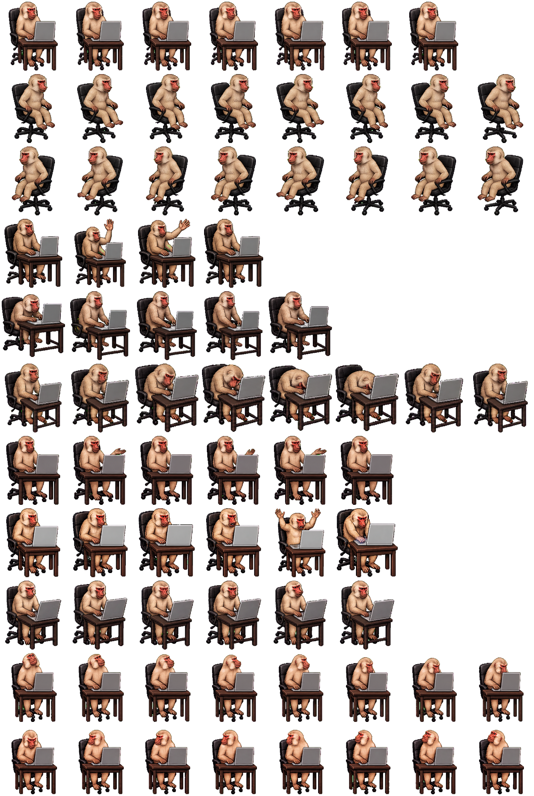

# Nullkey — Codex Pet

A stern pale macaque at a tiny coding workstation, with animations that escalate from typing to a comic keyboard smash. This custom Codex pet uses the sprite atlas v2 format.



## Files

- `pet.json` — pet metadata and sprite format version.
- `spritesheet.png` — transparent PNG, 1536 × 2288 px.

The atlas contains nine animation states and sixteen look directions in 192 × 208 px cells. The artwork matches the existing Nullkey pet.

## Install in Codex CLI

Download the two pet files into your Codex user pets directory:

```bash
mkdir -p "$HOME/.codex/pets/nullkey"
curl --fail --location "https://raw.githubusercontent.com/astahaha/nullkey-codex-pet/main/spritesheet.png" -o "$HOME/.codex/pets/nullkey/spritesheet.png"
curl --fail --location "https://raw.githubusercontent.com/astahaha/nullkey-codex-pet/main/pet.json" -o "$HOME/.codex/pets/nullkey/pet.json"
```

This replaces the metadata and PNG if Nullkey is already installed in that directory. If you use a custom `CODEX_HOME`, use its `pets/nullkey` directory instead.

Restart Codex CLI, open an interactive session, and enter `/pets nullkey`, or choose Nullkey with `/pets` or `/pet`.

## Compatibility

Terminal pets require a supported terminal, such as iTerm2 3.6 or later, or one with Kitty graphics or Sixel support. They are unavailable inside tmux and Zellij. The Codex IDE extension does not provide a pet picker.

This repository contains a v2 atlas measuring 1536 × 2288 px. The documented ChatGPT web upload form requires a 1536 × 1872 px sheet, so this file is not intended for direct upload through that form.

Local pet installations and the ChatGPT web pet library are separate. Deleting this repository does not uninstall a pet or delete an uploaded copy.

See the [official Pets documentation](https://learn.chatgpt.com/docs/pets) for availability and interface-specific behavior.
